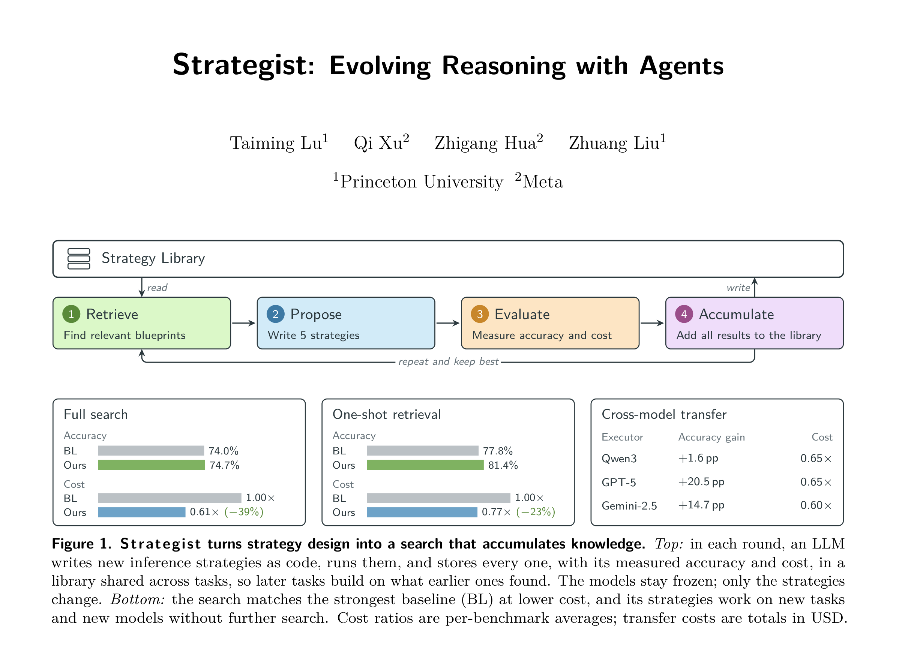

# Strategist

**Strategist: Evolving Reasoning with Agents.**



A model is only half of an agentic system. The other half is the inference strategy:
the reasoning procedure that turns model calls into a response. Strategist is a
meta-agent that designs that second half. Given a task and a small development set, it
retrieves related strategies from a library, writes new candidate strategies as code,
runs them on real samples, revises them from measured accuracy and cost, and puts every
candidate back into the library. The models stay frozen; only the strategies change.

This repository is the method at its starting point: the search loop, the blueprint
interface, library retrieval, and an empty library. Everything in the library is
written by the search.

## How it works

Each strategy is a **blueprint**: a Python file with one shared interface, so any
blueprint can be a component inside another. One search runs Algorithm 1 of the paper:

1. **Retrieve.** The strategist queries the library with a relevance query and an
   inspiration query (TF-IDF plus embedding similarity) and reads the cards of what
   comes back.
2. **Propose.** It writes 5 candidates per iteration: `new` designs, `composed` ones
   that import library blueprints, and `reuse` of a blueprint with task-specific prompts.
   While the library is empty, all candidates are `new`.
3. **Evaluate.** Every candidate runs on the training, validation and hidden splits of
   the development set; accuracy and token cost are measured per call.
4. **Accumulate.** Every candidate enters the library with a measurement card and the
   strategist's experience notes, and the next iteration starts from the results.

After `N` iterations the pick is the candidate that beats the reference strategy on the
validation and hidden splits by the largest hidden margin, or the reference itself
(`--reference`); without a reference, the highest hidden-set accuracy.

## Layout

```
strategist/
  search.py          the search loop (command line entry point)
  backends.py        the strategist LLM: codex, claude-opus, claude-minimax
  retrieval.py       library retrieval (TF-IDF + embeddings)
  experience.py      experience notes
  cards.py           measurement cards
  paired_pick.py     comparison with the reference strategy, final pick
  prompt_slots.py    a blueprint's prompt slots and per-run overrides
  scoring.py         grading of outputs against gold answers
  common.py          paths, JSONL helpers, code-task execution
  stop_flag.py       cooperative stop for a detached run
  prompts/           system.md, create.md, revise.md, continue.md, personas/
  basic/             the primitives: generate, chat, agent (OpenHands)
  blocks/            single-step blocks: review, revise, select, decompose, ...
  workflows/         the library; empty except the shared answer-extraction helper
  data/              your task files (format in data/README.md)
scripts/serve_executors.sh   serve the three executor tiers with vLLM
tests/
```

The code predates the paper's wording: `workflows/` is the library of blueprints, and
the strategist backend is stored under the name `commander` inside a run's log.

## Install

```bash
uv venv --python 3.12 .venv && source .venv/bin/activate
uv pip install -e ".[serve]"      # vLLM for the executors, OpenHands for the agent primitive
```

## Executors

Strategies call three model tiers, `fast`, `balanced` and `complex`, each in `nothink`
and `thinking` mode, through OpenAI-compatible endpoints. The paper's tiers are
Qwen3-0.6B, Qwen3-1.7B and Qwen3-4B:

```bash
bash scripts/serve_executors.sh
# fast=http://HOST:8001/v1,balanced=http://HOST:8002/v1,complex=http://HOST:8003/v1
```

## Run a search

Put the development questions in `strategist/data/<task>_val.jsonl`, one
`{"task": ..., "answer": ...}` per line (`strategist/data/README.md`), then:

```bash
python strategist/search.py \
  --benchmark my_task --val-set strategist/data/my_task_val.jsonl \
  --description "Grade-school word problems; the answer is one number." \
  --endpoints "fast=http://HOST:8001/v1,balanced=http://HOST:8002/v1,complex=http://HOST:8003/v1" \
  --strategist codex --iterations 10
```

- `--strategist`: `codex` runs the Codex CLI (model from `STRATEGIST_MODEL`),
  `claude-opus` the Anthropic API (`ANTHROPIC_API_KEY`), `claude-minimax` the Claude
  Code CLI on a MiniMax endpoint (`MINIMAX_API_KEY`).
- `--description`: what the task asks for, shown to the strategist (text or a file).
- `--reference BLUEPRINT@TIER/MODE`: the strategy to beat, a library blueprint at one
  anchor, for example a chain-of-thought blueprint you wrote (see below). It is measured
  in iteration 1 and every candidate is compared with it question by question.
- `--models` names the model behind each tier (default: the Qwen3 tiers above).
- The development file is split into training, validation and hidden sets of 100 rows
  each (`--feedback-n`, `--blind-n`, `--hidden-n`). If
  `strategist/data/<task>_test.jsonl` exists, the pick is also run on its first
  `--test-n` rows.

A run writes to `runs/<task>/`: `log.jsonl` (every candidate's measurements),
`prompts_sent/`, `raw/` (the strategist's replies), `generations/` (every executor call)
and `test_results/`. The candidates' code, cards, sidecars and experience notes go into
`strategist/`, where the next run finds them. A run resumes from its log, and
`STRATEGIST_STOP_FILE=<path>` makes it stop when that file appears.

## Write a blueprint

A blueprint is one file in `strategist/workflows/` with a `META` dict and an `execute`
coroutine. This one is chain of thought:

```python
from strategist.basic import generate
from strategist.workflows._qa_common import extract_answer

META = {
    "name": "chain_of_thought",
    "description": "Ask the model to think step by step before answering.",
    "when_to_use": "When the task requires reasoning: math, logic, multi-step problems.",
    "tags": ["reasoning", "single-shot"],
    "uses": ["generate"],
    "traits": {"foundation": "generate", "reasoning": True, "multi_path": False},
}

async def execute(llm, task: str) -> str:
    raw = await generate(llm, f"{task}\n\nThink step by step.", max_tokens=16384)
    return extract_answer(task, raw)
```

- `execute(llm, task)` receives one client, resolved from the candidate's anchor
  (for example `complex/thinking`). `execute(llms, task)` with the anchor `multi`
  receives the full dict `llms[tier][mode]` for routing across tiers.
- Blueprints compose by import: `from strategist.workflows.chain_of_thought import
  execute as cot`. Blocks call only primitives.
- Prompt literals are the blueprint's prompt slots; a candidate can override them for
  one run (`reuse` plus `prompts`) without touching the library file.

## Tests

```bash
uv pip install -e ".[dev]"
python -m pytest tests -q
```

## Citation

```bibtex
@misc{strategist,
   title={Strategist: Evolving Reasoning with Agents}, 
   author={Taiming Lu and Qi Xu and Zhigang Hua and Zhuang Liu},
   booktitle = {Advances in Neural Information Processing Systems},
   year      = {2026}
}
```
